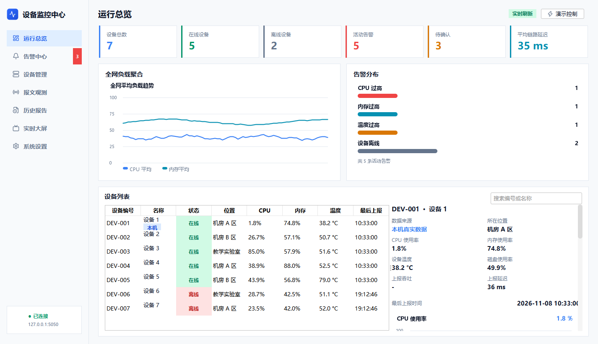

# 局域网设备状态监控与告警系统

这是一个基于 Java Socket 的局域网设备监控系统。设备模拟器通过 TCP 上报 CPU、内存和温度，服务器完成认证、指标校验、SQLite 持久化、阈值告警和实时广播，Swing 监控端显示设备状态、活动告警和历史数据。

## 主要功能

- 设备和监控人员分别认证
- 多设备 TCP 长连接与心跳
- CPU、内存和温度指标上报
- 15 秒离线检测及恢复
- CPU、内存、温度和离线告警，带滞回、连续采样和恢复
- 告警分级（提示/警告/严重），支持确认备注、人工解决和完整处理记录
- 每设备独立告警阈值，设备未配置时使用全局默认值
- FlatLaf 现代化五页面界面：运行总览 / 告警中心 / 设备管理 / 历史报告 / 系统设置
- 全网聚合负载趋势、告警分布、实时详情卡和状态标签
- 设备注册（自动签发凭证）、编辑、停用/启用、凭证重置
- 操作审计日志、服务器运行状态、监控账号修改密码
- 历史报告：时间范围查询、统计摘要、趋势图和 UTF-8 CSV 导出
- 历史报告 PDF 一键导出（内嵌中文字体）
- TLS 加密传输：服务器同时提供明文 5050 与 TLS 5051 端口，客户端经信任库
  校验证书，未知证书拒绝连接并计入统计（`scripts/init-keystore.ps1` 一键生成）
- 协议报文观测：监控端实时展示收发的 JSON 协议帧（时间/方向/类型/字节数），
  支持暂停与清空
- 断线自动重连：指数退避（1s 起、倍增、封顶 30s），服务器重启后自动恢复
- 实时 Web 监控大屏：侧边栏一键打开浏览器深色大屏，拓扑流光、告警流、
  性能曲线与延迟热力每秒实时推送（自研 HTTP/1.1 + RFC 6455 WebSocket，零新依赖）
- 正常、CPU 异常、内存异常、高温、振荡、断线和重连模拟场景
- 20 台设备并发负载测试
- JUnit 5 单元测试和真实 socket 集成测试
- 一键启动和停止本地演示脚本



## 技术架构

```text
Swing 监控客户端 ──TCP/JSON──┐
                              ├── Java 监控服务器 ── SQLite
设备模拟器 ────────TCP/JSON──┘
```

TLS 接入（可选，默认开启演示）：服务器在 5050 之外监听 5051，使用
`config/tls/server-keystore.p12` 自签名证书；模拟器与监控端携带
`config/tls/client-truststore.p12` 建立加密连接。

实时大屏数据链路（Swing 客户端内嵌 Web 服务，仅绑定 127.0.0.1）：

```text
监控客户端事件流 ──> web.WebDashboard（快照 + 每秒广播）
                          │ WebSocket（自研 RFC 6455）
                          ▼
              浏览器实时大屏（ECharts，离线可用）
```

服务器模块：

- TCP 连接与会话管理
- 角色认证与协议校验
- 设备在线状态和心跳
- 告警规则引擎
- SQLite 数据访问和事务
- 监控客户端广播
- 历史数据查询
- FlatLaf 界面主题与 Swing 自绘趋势图
- 告警确认协议和旧数据库无破坏迁移

## 环境要求

- JDK 17
- Maven 3.9 或兼容版本
- Windows 10/11（启动脚本使用 PowerShell）

开发时使用的实际版本为 OpenJDK 17.0.21.0.2 和 Maven 3.9.9。

## 构建与测试

在项目根目录运行：

```powershell
powershell -NoProfile -ExecutionPolicy Bypass -File .\scripts\verify.ps1
```

该命令执行：

1. Java 17 编译
2. JUnit 单元测试和 socket 集成测试
3. 可执行 JAR 打包
4. JAR 启动冒烟检查

构建日志和启动检查输出保存在 `test-results/`。可执行文件：

```text
target/device-monitor-0.1.0-SNAPSHOT-all.jar
```

## 首次运行

使用新数据库初始化演示账号和设备：

```powershell
.\scripts\seed-demo.ps1 -DeviceCount 5 -Database data/device-monitor.db -Output config/demo.properties
```

初始化命令会生成随机监控密码和设备凭据，并写入被 `.gitignore` 排除的 `config/demo.properties`。不要把该文件提交到公开仓库。

服务器会优先读取 `config/server.properties`。如果没有该文件，则使用 `config/server.properties.example`：

```powershell
Copy-Item .\config\server.properties.example .\config\server.properties
```

确认 `database.path` 指向刚初始化的数据库。默认示例配置为 `data/device-monitor.db`。

## 启动监控

### 一键演示

先初始化演示数据，并确认 `config/server.properties` 的 `database.path` 指向
`data/device-monitor.db`：

```powershell
.\scripts\seed-demo.ps1 -DeviceCount 7 `
    -Database data/demo-v2.db `
    -Output config/demo.properties
powershell -NoProfile -ExecutionPolicy Bypass -File .\scripts\start-demo.ps1
```

如果 `config/server.properties` 不存在，脚本会从模板创建；存在时不会覆盖。
脚本先检查 5050 端口和目标 JAR，再启动服务器、7 台混合场景模拟设备和监控端。演示结束后运行：

```powershell
powershell -NoProfile -ExecutionPolicy Bypass -File .\scripts\stop-demo.ps1
```

需要展示登录页面时使用：

```powershell
powershell -NoProfile -ExecutionPolicy Bypass -File .\scripts\start-demo.ps1 -ShowLogin
```

停止脚本只处理 `.run` 中记录且命令行指向本项目 JAR 的进程。

### 分步启动

打开三个 PowerShell 窗口。

窗口 1，启动服务器：

```powershell
.\scripts\start-server.ps1
```

窗口 2，启动模拟设备：

```powershell
.\scripts\start-simulators.ps1 -DeviceCount 5 -Scenario MIXED -DurationSeconds 120
```

窗口 3，登录监控端：

```powershell
.\scripts\start-monitor.ps1
```

登录界面会自动填入本地演示账号。也可以直接自动登录：

```powershell
.\scripts\start-monitor.ps1 -AutoLogin
```

## 演示场景

`MIXED` 按设备顺序分配场景：

| 设备序号 | 场景 | 效果 |
|---|---|---|
| 1 | NORMAL | 正常指标波动 |
| 2 | CPU | 连续高 CPU，触发 CPU 告警 |
| 3 | MEMORY | 内存超过 85% 触发内存告警 |
| 4 | TEMPERATURE | 温度超过 75°C |
| 5 | DISCONNECT | 主动断开并触发离线告警 |
| 6 | RECONNECT | 离线超过 15 秒后重新连接并恢复离线告警 |
| 7 | OSCILLATION | CPU 大幅振荡，周期越过阈值 |

可单独指定场景：

```powershell
.\scripts\start-simulators.ps1 -DeviceCount 1 -Scenario CPU -DurationSeconds 60
```

可选场景：`NORMAL`、`CPU`、`MEMORY`、`TEMPERATURE`、`DISCONNECT`、
`RECONNECT`、`OSCILLATION`、`MIXED`。

## 告警规则

配置位于 `config/server.properties.example`：

| 规则 | 默认阈值 |
|---|---|
| CPU 告警 | 连续 3 次高于 80% |
| CPU 恢复 | 连续 3 次不高于 75% |
| 温度告警 | 达到或超过 75°C |
| 温度恢复 | 低于 70°C |
| 内存告警 | 连续 3 次高于 85% |
| 内存恢复 | 连续 3 次不高于 78% |
| 设备心跳 | 每 5 秒 |
| 离线判定 | 15 秒无有效消息 |

同一设备同一规则最多存在一条活动告警。恢复后的告警保留在历史记录中。

监控人员可在“告警中心”选择活动告警并点击“确认并备注”或“标记解决”。确认只记录
首次处置人、时间和备注，不改变告警的活动状态；规则恢复条件仍由服务器判断。
达到阈值 + 10 的告警自动标记为“严重”级别。

在“设备管理”可以按设备覆盖上述阈值、注册新设备、重置接入凭证。所有管理操作
写入审计日志，可在“系统设置”查看。

## 历史数据与导出

在“历史报告”页面选择设备（或全部设备）和时间范围后点击“查询历史”：

- 顶部显示样本数、CPU 平均/峰值、内存平均、温度峰值和告警条数统计。
- “指标趋势”显示 CPU、内存和温度曲线及对应阈值。
- “指标记录”和“告警记录”显示查询范围内的明细。
- “导出指标 CSV”和“导出告警 CSV”只导出客户端已经取得的数据。

历史查询和告警确认都通过已认证的监控连接执行，客户端不会直接打开 SQLite 数据库。

## 并发负载测试

10 分钟正式测试：

```powershell
.\scripts\run-load-test.ps1 -DeviceCount 20 -DurationSeconds 600 -IntervalMillis 1000
```

测试程序自动创建临时数据库、服务器、20 个测试设备和 1 个监控连接，不依赖外部数据库进程。

输出：

```text
test-results/load-test-summary.csv
test-results/load-test-latency-samples.csv
```

快速冒烟测试可把持续时间改为 10 秒。

## 数据与日志

- 正式数据库：由配置中的 `database.path` 指定
- 演示凭据：`config/demo.properties`，不进入提交包
- 服务器日志：运行终端输出
- 测试构建日志：`test-results/maven-build-output.txt`

数据库启用外键、WAL 和 5 秒 busy timeout。指标和同一次处理产生的告警变化在同一事务中提交。

## 安全说明

- 密码和设备凭据使用 PBKDF2-HMAC-SHA256、随机盐和 120,000 次迭代保存。
- 服务端限制消息为 64 KiB，并验证角色、字段类型和指标范围。
- 同一连接认证失败 5 次后关闭。
- 本期提供基于自签名证书的 TLS 加密（默认端口 5051），用于受控局域网教学演示；
  未接入 CA 签发证书，不能视为生产级安全通信。
- 演示配置包含明文凭据，仅用于本机运行，并被版本控制忽略。
- 实时大屏 Web 服务仅绑定 127.0.0.1（默认端口 8088，可在
  `config/ui.properties` 中通过 `web.enabled` / `web.bind` / `web.port` 调整），
  并校验 Origin 请求头，不作为对外服务。

## 已知限制

- 当前为单服务器结构，不支持集群和高可用。
- 数据库未实现自动历史数据清理和备份调度。
- 监控端断线后按指数退避自动重连（1 秒起，封顶 30 秒），重连期间数据在
  下一次快照同步。
- 未接入真实硬件传感器。
- 浏览器端目前为只读大屏，不支持在大屏上直接执行管理操作。

## 目录

```text
device-monitor/
├─ pom.xml
├─ README.md
├─ config/
├─ screenshots/
├─ scripts/
├─ src/
└─ screenshots/web-dashboard.png
```

`target/`、`data/`、`logs/`、`.run/`、`config/server.properties` 和 `config/demo.properties` 为本地运行产物，不进入源码提交包。
